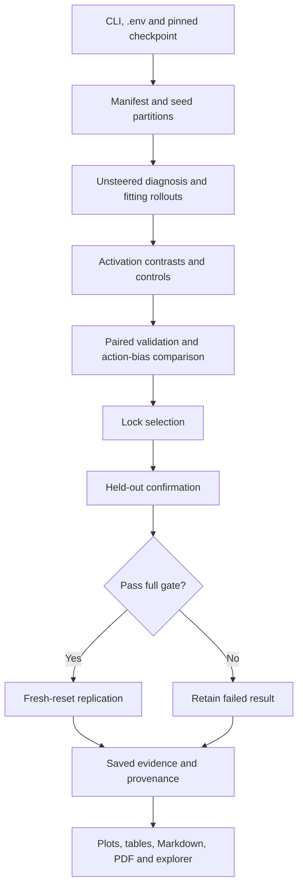

# RL locomotion steering vectors

Can a small change inside a frozen reinforcement-learning policy change how it moves, without retraining it? This project extracts a direction from contrasting hidden activations in unsteered rollouts, adds that direction during inference, and tests locomotion against baselines and controls. It uses **no behavioral cloning** and never updates the evaluated policy's weights.

The method adapts [contrastive activation addition](https://arxiv.org/abs/2312.06681) to continuous control, building on [earlier interventions in RL maze policies](https://arxiv.org/abs/2310.08043). The contribution is a reproducible locomotion experiment and its evidence, not the invention of activation steering. The Python pipeline combines PyTorch, Stable-Baselines3, Baukit, Gymnasium and MuJoCo with saved-data reporting and an interactive evidence explorer. [Sources and adaptation boundaries](docs/sources.md).

**What we found:** Ant's ground path can shift toward world +Y, with costs to effort, reward or physical reliability. Its original confirmation failed the full acceptance gate. HalfCheetah attempts exposed unstable extraction, failed validation, and failed confirmation; no primary method has completed successful confirmation and replication. Some controls passed pilot gates. These results support measured intervention effects, not reliable semantic control or generalization across trained policies. [Complete experiment register](reports/experiments.md).


The figure uses predetermined episodes with equal world-X/world-Y distance scales; crosses mark failed endpoints. The **fixed-camera movie below replays the figure's historical validation example**. Baseline is left, steering right; both panels share a stationary world frame. Grid, rings and trails are visual annotations. Neither example is new confirmation or application evidence.

https://github.com/user-attachments/assets/9e0719a6-c15b-474e-b74e-3c5e70954e2a

[Other camera views and pinned reproduction commands](docs/ant-videos.md) · [Replay integrity audit](reports/ant-classic-005-causal-audit.md#camera-and-video-integrity) · [Interactive evidence explorer](https://BurnyCoder.github.io/reinforcement-learning-locomotion-steering-vectors/)

<!-- BEGIN GENERATED README RESULTS -->

## Results and limitations

### Original Ant confirmation

Adding the saved **256-dimensional lateral vector at strength -0.1** increases mean **world-Y ground-plane velocity by +0.402 m/s**, with a paired bootstrap 95% interval **[0.308, 0.491]**, across **30 confirmation pairs**. Forward-speed retention is **96.83%**. These are equal-episode means over available post-onset motion, not body-relative sidestepping or distance retention. [Saved results](reports/ant-classic-005/results.json).

**The original outcome remains `confirmation_failed`.** Baseline and treated arms each fail on 4/30 episodes, on partly different seeds. A shared episode ends before steering begins and triggers the strict prefix criterion. Squared action rises +17.84%, while mean post-onset reward falls from 6.239 to 5.864 per recorded step. Equal failure counts do not establish equal safety on each reset.

| Condition (strength) | Δ world-Y m/s | 95% interval | Forward speed retained | Squared-action change | Failures baseline → treated | Full gate |
| --- | --- | --- | --- | --- | --- | --- |
| unsteered baseline | +0.000 | reference | 100.00% | +0.00% | 4/30 (reference) | reference |
| lateral (-0.1) | +0.402 | [0.308, 0.491] | 96.83% | +17.84% | 4/30 → 4/30 | fail |
| lateral_bias (+0.5) | +0.134 | [0.076, 0.197] | 99.40% | +1.21% | 4/30 → 1/30 | fail |
| lateral_random0 (-0.05) | +0.155 | [0.095, 0.217] | 97.90% | -4.58% | 4/30 → 3/30 | fail |
| lateral_random1 (-0.1) | +0.253 | [0.195, 0.311] | 95.72% | +7.34% | 4/30 → 7/30 | fail |
| lateral_random2 (-0.05) | +0.155 | [0.089, 0.219] | 96.31% | -6.22% | 4/30 → 9/30 | fail |
| lateral_shuffled (-0.2) | +0.890 | [0.771, 0.980] | 88.31% | +14.12% | 4/30 → 9/30 | fail |

Every confirmed primary/control arm is shown at its own validation-selected strength. Intervals are the original paired percentile bootstrap intervals; all comparisons share the unsteered baseline. The baseline is a reference, without a comparison interval or success gate. A larger world-Y effect does not by itself mean better locomotion.


In plain language, the primary's measured mean shift is larger than the action bias and the displayed random controls, but it increases action effort. The shuffled-label direction has a still larger mean shift while sacrificing forward speed and increasing failures. None passes the full confirmation gate. These are descriptive comparisons, not tests of superiority between directions. See [the findings](reports/ant-classic-005-findings.md) for the physical-quality criteria.

### Later audit and component ablations

On a **separate cohort of 20 resets**, the locked primary produces **+0.462 m/s [0.343, 0.587]** (paired BCa 95% interval). Failures increase from 0/20 to 2/20. Its sign-dependent response ranks at **p = 0.05** against 99 norm-matched random directions. **Lateral-label specificity is unsupported:** the turning-derived direction has a stronger response. This audit consumed a previously reserved application cohort; it is not the formal replication split.

| Audit arm | Δ world-Y m/s | 95% interval | Forward speed retained | Squared-action change | Failures |
| --- | --- | --- | --- | --- | --- |
| baseline | +0.000 | reference | 100.00% | +0.00% | 0/20 |
| lateral -0.1000 | +0.462 | [0.343, 0.587] | 96.40% | +17.40% | 2/20 |
| turning -0.1000 | +0.568 | [0.438, 0.684] | 96.50% | +6.83% | 1/20 |
| heading_parallel -0.1000 | +0.570 | [0.485, 0.666] | 98.55% | +1.60% | 4/20 |
| heading_orthogonal -0.1000 | +0.010 | [-0.098, 0.116] | 98.76% | +16.62% | 2/20 |
| heading_orthogonal_renorm -0.1000 | -0.131 | [-0.311, 0.062] | 81.44% | +47.09% | 8/20 |
| heading_axis_renorm -0.1000 | +0.551 | [0.444, 0.654] | 98.79% | +0.80% | 2/20 |
| perceived_heading -0.160876rad | +0.903 | [0.816, 0.998] | 97.50% | +0.24% | 0/20 |

For compactness, this table shows the baseline and **every negative-strength named arm**, including all heading-component ablations and the negative observation transformation; rows were not chosen by effect size. The primary and observation-transform intervals are saved paired BCa intervals. The remaining comparison intervals are descriptive paired percentile intervals, unadjusted for multiple comparisons. The [complete signed audit](reports/ant-classic-005-independent-audit.md), [control alignment audit](reports/scientific-rigor-audit.md), and [explorer](https://BurnyCoder.github.io/reinforcement-learning-locomotion-steering-vectors/) include both signs, random/shuffled ensembles, control cosines and odd/even responses. The baseline has no comparison interval.


Removing the heading-aligned component changes the response. Its norm-matched remainder still shifts behavior at the opposite, positive sign, with severe locomotion costs (see the complete signed audit); the negative arm above has an interval containing zero. Projection ablations and the observation intervention support **heading involvement**, without establishing exact physical-heading equivalence or a unique semantic mediator. The historical transformation rotates and reclips already-clipped contact wrenches: `clip(R clip(f))` generally differs from physical rotation's `clip(R f)`. No historical treatment or result is changed by this qualification.


These are **evaluation rewards**, averaged over observed segments and accompanied by available-episode counts; failed episodes remain included and curves stop at termination. Training-loss curves are unavailable for the evaluated frozen upstream checkpoints. Generalization across independently trained policies, new domains or real robots has not been established. [Estimators, provenance and full-precision evidence](reports/ant-publication/evidence.json) · [All experiments, including HalfCheetah's negative results](reports/experiments.md).

<!-- END GENERATED README RESULTS -->

## Method and architecture

The evaluated policies are the revision-pinned Farama-Minari [HalfCheetah TQC](https://huggingface.co/farama-minari/HalfCheetah-v5-TQC-medium/tree/b4ce04da6f246f06ae4c4258b8ab39624e6600b4) and [Ant SAC](https://huggingface.co/farama-minari/Ant-v5-SAC-medium/tree/de5978d34b0118341df2b0a30232c5d2bfcb148e) checkpoints. Upstream sources attribute them to online RL; this project verifies checkpoint bytes and inference, rather than independently reconstructing their training history. The evaluated weights remain frozen.

Healthy fitting windows define high/low behavior groups. Their episode-weighted activation-mean difference is scaled to the fitting activations' centered RMS. A [Baukit forward hook](https://github.com/davidbau/baukit/blob/9d51abd51ebf29769aecc38c4cbef459b731a36e/baukit/nethook.py) adds `alpha * direction` after the actor's first ReLU; ordinary policy prediction computes the actions. Fitting data, validation data and held-out evaluation have separate roles.

Paired validation sweeps compare activation vectors, norm-matched random directions, shuffled-label directions and constant action biases. Selection is saved before confirmation. Eligible confirmed candidates proceed to fresh-reset replication using the same checkpoint; only replicated candidates can enter the application workflow. Failed evaluation episodes stay in the analysis. See [methodology](docs/methodology.md) for exact weighting, filtering, physical-quality gates and inference limits.



The thin CLI coordinates runtime, analysis, storage and reporting modules. Saved-data publication reads evidence independently of the simulator. A failed gate is a completed research outcome, not a successful steering application.

## Install and reproduce

Install [Git](https://git-scm.com/downloads) and [uv](https://docs.astral.sh/uv/getting-started/installation/), then run this PowerShell quickstart. `uv` uses the project's Python requirement, local `.venv`, and committed lockfile.

```powershell
git clone https://github.com/BurnyCoder/reinforcement-learning-locomotion-steering-vectors.git
cd reinforcement-learning-locomotion-steering-vectors
uv sync --locked
if (-not (Test-Path .env)) { Copy-Item .env.example .env }
```

**Rebuild the published evidence first:**

```powershell
uv run --locked --no-sync python scripts/build_ant_publication.py
uv run --locked --no-sync python scripts/build_ant_publication.py --check
```

The build restores missing evidence from a pinned public Hugging Face revision, verifies hashes, and regenerates the empirical tables and figures shown here, current Ant reports/PDFs, and explorer data. A present input with a wrong hash is rejected. `--check` compares temporary regenerated outputs without modifying publications or restoring missing inputs. Neither command loads a policy or collects simulator episodes. Internet access is needed for missing downloads; no API key is required. [Full publication instructions](docs/ant-publication.md).

**Run a new experiment:** first register its hypothesis, metrics and analysis plan, choose a new run directory, and set a seed offset in `.env` that avoids every reserved or consumed cohort. Review the [seed guidance](docs/usage.md#seed-allocation-and-configuration) and [configuration reference](.env.example) before collecting evidence.

```powershell
uv run --locked --no-sync locomotion-steering run --model halfcheetah --run-dir runs/my-halfcheetah-experiment
uv run --locked --no-sync locomotion-steering report --run-dir runs/my-halfcheetah-experiment
uv run --locked --no-sync pytest -q
```

Use `--model ant` for Ant. `run` downloads the pinned policy when needed, performs simulator rollouts and saves numerical evidence; `report` reads that run to produce Markdown, PDF and plots. No eligible vector or a failed confirmation is a valid result. The measured stack uses CPU inference and has been exercised on native Windows; other platforms require runtime verification. Keep the [pinned dependencies](uv.lock) when reproducing these results.

[Usage guide](docs/usage.md): resume and stop boundaries, replay, retargeting, application eligibility, configuration, logs and artifact provenance. [Published Ant vector and movie reproduction](docs/ant-videos.md) provides the concrete download/replay workflow.

## Features and technologies

| Capability | Implementation |
| --- | --- |
| Frozen-policy inference and activation intervention | [PyTorch](https://pytorch.org/), [Stable-Baselines3](https://stable-baselines3.readthedocs.io/en/v2.4.1/), [SB3-Contrib TQC](https://sb3-contrib.readthedocs.io/en/v2.4.0/modules/tqc.html), [Baukit](https://github.com/davidbau/baukit) |
| Locomotion simulation and audited replay | [Gymnasium](https://gymnasium.farama.org/), [MuJoCo](https://mujoco.readthedocs.io/en/3.1.5/python.html), ImageIO/FFmpeg |
| Contrasts, controls, paired estimates and audits | NumPy, SciPy; saved arrays and explicit selection artifacts |
| Reproducible setup and checkpoint downloads | [uv](https://docs.astral.sh/uv/guides/projects/), python-dotenv, [Hugging Face Hub](https://huggingface.co/docs/huggingface_hub/) |
| Figures, papers and interactive exploration | Matplotlib, ReportLab, static HTML/CSS/JavaScript on GitHub Pages |
| Mechanics and reproducibility checks | pytest, artifact hashes, timestamped invocation logs |

Exact packages and versions are in [pyproject.toml](pyproject.toml) and [uv.lock](uv.lock); [source and license notes](docs/sources.md) distinguish library APIs, project adaptations and unresolved upstream-weight redistribution terms. Upstream policy weights are referenced, not repackaged. The [alternative-method prototype](docs/pgs-adaptation.md) remains paused and has not produced an experiment result.

## Research records

- [Experiment register and glossary](reports/experiments.md): every completed experiment, unsuccessful outcomes, policy inventory and lessons.
- [Paper](reports/paper.md) and [PDF](reports/paper.pdf): technical results and limitations; [current Ant findings](reports/ant-classic-005-findings.md) and [independent audit](reports/ant-classic-005-independent-audit.md) provide detailed comparisons.
- Recorded protocols: [smaller-strength HalfCheetah](reports/hc-height-speed-004-preregistration.md), [original Ant](reports/ant-classic-005-preregistration.md), and [later Ant audit](reports/ant-classic-005-independent-audit-preregistration.md). The original Ant protocol entered Git after diagnostics/fitting began; the [chronology ledger](reports/ant-publication-completion.md) preserves this limitation. These links do not imply retrospective preregistration compliance.
- [Scientific-rigor audit](reports/scientific-rigor-audit.md), [documentation audit](reports/documentation-audit.md), and [source audit](docs/sources.md): evidence behind claims, corrections and verification scope.
- [Published steering artifacts](https://huggingface.co/BurnyCoder/rl-locomotion-steering-vectors), [interactive explorer](https://BurnyCoder.github.io/reinforcement-learning-locomotion-steering-vectors/), and [publication reproduction](docs/ant-publication.md).
- [Contributor guidance](AGENTS.md): research and development constraints.
