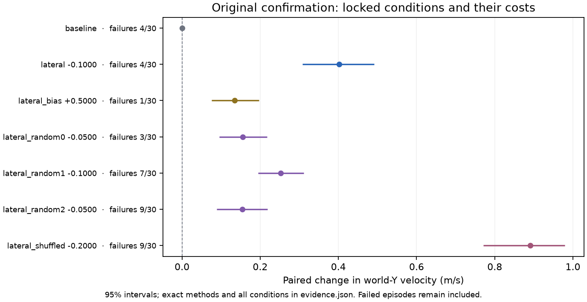
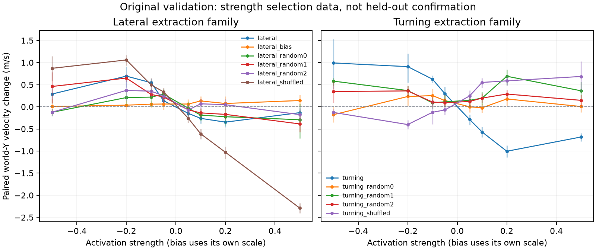
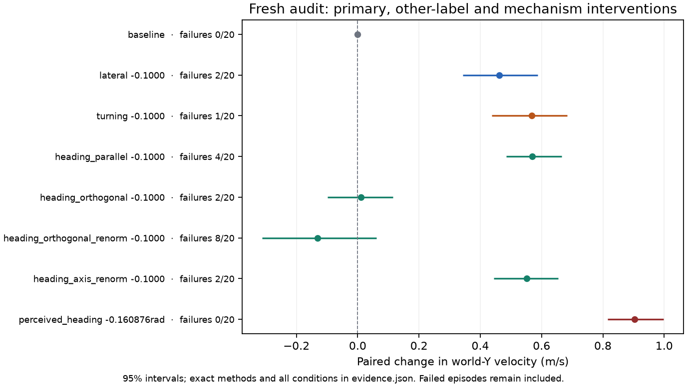
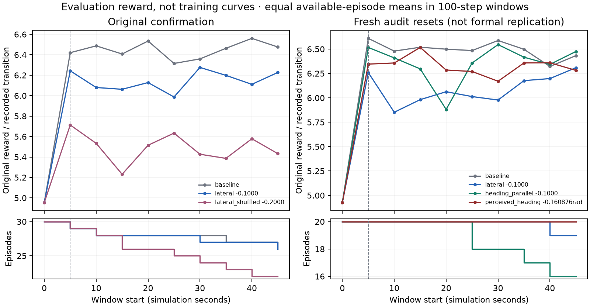

# Ant 005: world-Y velocity steering, with failed formal acceptance

This is the current generated account of the existing result. It supersedes the interpretation in the [historical narrative](https://github.com/BurnyCoder/reinforcement-learning-locomotion-steering-vectors/blob/fc8cf63/reports/ant-classic-005-findings.md); original numerical artifacts and protocol decisions are unchanged. Author: Libor “Burny” Burian.

## Question and method

The question was whether a frozen Ant SAC actor contains an activation contrast that produces a useful, repeatable change in lateral movement or turning. “Lateral” is the original vector key; its evaluation coordinate is **world-Y ground-plane velocity**, not a body-relative sidestep. The [locally dated protocol](ant-classic-005-preregistration.md) records the pilot hypotheses and quality gates. Its first Git record follows the start of diagnostics/fitting, so it is not independently verifiable preregistration before any results.

The checkpoint has 105 observations, 8 actions, and a first hidden layer of 256 ReLU units. It is the [pinned Farama-Minari SAC checkpoint](https://huggingface.co/farama-minari/Ant-v5-SAC-medium/tree/de5978d34b0118341df2b0a30232c5d2bfcb148e), SHA256 `dea0e6dbb847776ac9e91dc8b7df5ba975742924eb55831d2da08a0abc786ca2`. We use deterministic inference and do not update policy weights. Upstream training provenance is distinct from independently reproduced training history.

After 16 diagnostic and 64 fitting episodes, the extraction uses complete 100-step windows following a 100-step warmup. 531/531 fitting windows are eligible under the saved rules. The high/low quartile activation means are episode-weighted, differenced, and scaled to the fitting activation RMS. The saved lateral norm is 5.15135; strength -0.1 applies an offset of norm 0.51513. Its split-half cosine is 0.966. These stability diagnostics describe extraction, not causal usefulness.

The implementation adapts [contrastive activation addition](https://arxiv.org/abs/2312.06681) to continuous-action locomotion. Earlier [maze-policy work](https://arxiv.org/abs/2310.08043) and [top-right steering](https://turntrout.com/top-right-steering-vector) already intervened on frozen RL activations. Episode weighting, movement filters, RMS scaling and usefulness gates are project choices, documented in [methodology](../docs/methodology.md) and [sources](../docs/sources.md).

## Data separation and selection

| Cohort | Seeds | Role |
| --- | --- | --- |
| diagnostic | 500000–500015 | observed |
| fit | 501000–501063 | observed |
| validation | 510000–510009 | observed |
| confirmation | 520000–520029 | observed |
| replication | 530000–530029 | unused reservation |
| independent audit | 540000–540019 | observed; includes former application reservation |

The original run evaluated 88 validation conditions and selected the lateral strength -0.1 before confirmation. 6 conditions were confirmed; each comparator retained its own validation-selected strength. The fitting data determine vectors, validation determines strength, and confirmation estimates the locked outcomes. The later audit has separate provenance and must not be pooled with confirmation or described as the unused formal replication split.

## Original confirmation results

The primary shifts mean world-Y velocity from 0.175 to 0.577 m/s: **+0.402 m/s**, paired percentile-bootstrap 95% interval **[0.308, 0.491]**. Mean world-X speed changes from 6.262 to 6.063 m/s, retaining **96.83%**. This is speed retention, not distance retention or a gait-similarity measurement.

| Condition (strength) | Δ world-Y m/s | 95% interval | Forward speed retained | Squared-action change | Failures baseline → treated | Full gate |
| --- | --- | --- | --- | --- | --- | --- |
| lateral (-0.1) | +0.402 | [0.308, 0.491] | 96.83% | +17.84% | 4/30 → 4/30 | fail |
| lateral_bias (+0.5) | +0.134 | [0.076, 0.197] | 99.40% | +1.21% | 4/30 → 1/30 | fail |
| lateral_random0 (-0.05) | +0.155 | [0.095, 0.217] | 97.90% | -4.58% | 4/30 → 3/30 | fail |
| lateral_random1 (-0.1) | +0.253 | [0.195, 0.311] | 95.72% | +7.34% | 4/30 → 7/30 | fail |
| lateral_random2 (-0.05) | +0.155 | [0.089, 0.219] | 96.31% | -6.22% | 4/30 → 9/30 | fail |
| lateral_shuffled (-0.2) | +0.890 | [0.771, 0.980] | 88.31% | +14.12% | 4/30 → 9/30 | fail |

The baseline is shared across conditions. The shuffled control is not a label-free null: its construction retains the fitting activation geometry. Random controls and the action-space comparator show that generic perturbations can also move the path. Failure costs and differing selected strengths prevent reading the largest effect as the best controller.

The status is **`confirmation_failed`**. Every pair is retained. An episode ending before intervention receives zero for unavailable post-onset summary outcomes and still counts as a failure; the strict prefix criterion independently rejects the condition. Other episodes use their available post-onset steps. This convention is not a general missing-data correction or a fixed-horizon estimand. Baseline and treated failure counts are each 4/30, with different failed-seed identities. Squared-action effort rises +17.84%; mean post-onset reward falls from 6.239 to 5.864 per step. No practical-target application is claimed.

## Later audit and mechanism limits

The separately preregistered audit contains 5020 episodes across 251 arms on 20 resets. It reproduces **+0.462 m/s [0.343, 0.587]**, with 19 positive pairs, while treatment failures increase from 0 to 2. The rank p-value against 99 isotropic directions is 0.05; against 19 shuffled-label redraws it is 0.40. The turning-label direction is stronger. These findings do not establish lateral-label specificity.

Projection ablations and the observation intervention support a heading-related account. At a negative observation rotation of 9.22 degrees, the measured world-Y effect is +0.903 m/s [0.816, 0.998]. That intervention changes observation channels only, while the simulator state remains unedited. Because contact channels were already clipped before rotation, it computes `clip(R clip(f))`, not generally `clip(R f)`. Quaternion and world linear-velocity rotations do not fix that loss of force magnitude. Exact physical-state equivalence and unique heading mediation remain unestablished.

| Saved cohort | States with clipped planar wrench component | Post-onset states | Pooled fraction |
| --- | --- | --- | --- |
| fitting | 8444 | 53409 | 15.81% |
| audit baseline | 2801 | 18000 | 15.56% |

The clipping count is a new descriptive reduction of existing observations, not a fresh experiment. It does not estimate the clipping discrepancy's causal contribution. See the [generated independent-audit report](ant-classic-005-independent-audit.md) for ablations, alternative estimands, negative evidence and historical checks.

## Learnings and limits

The measured target can change without producing a controller that satisfies its original acceptance rule. World-Y motion can reflect heading involvement rather than a pure sidestep. A component ablation and an observation intervention constrain explanations more than a cosine alone, but do not identify a unique latent semantic feature. Shared baselines require joint resampling for cross-arm inference; matching displacement and a derived travel angle is arithmetic rather than independent mechanism evidence.

The original fitting sensitivities, paired replay checks and source audits remain linked in the [diagnostics](ant-classic-005-diagnostics.md), [causal audit](ant-classic-005-causal-audit.md), [specificity audit](ant-classic-005-y-shift-audit.md) and [path audit](ant-classic-005-mechanism-audit.md). Their numbers and run history are preserved. The correction here narrows interpretation and prevents future seed reuse.

Only the evaluated checkpoint, simulator, layer, strengths and horizons are covered. Reset-seed evidence does not establish training-seed robustness. No new training, retuning, formal replication, application, or alternative-method experiment was performed for this completion. Training-loss curves and experimental LLM prompt logs are inapplicable.

## Reproduce and explore

Run `uv run --locked --no-sync python scripts/build_ant_publication.py` from the repository root. It restores missing pinned inputs, verifies hashes, and regenerates current tables, figures, prose and PDFs without loading the policy. `--check` compares generated outputs for staleness. [Instructions and completion ledger](../docs/ant-publication.md) · [all generated evidence](ant-publication/evidence.json) · [interactive explorer](https://BurnyCoder.github.io/reinforcement-learning-locomotion-steering-vectors/).
