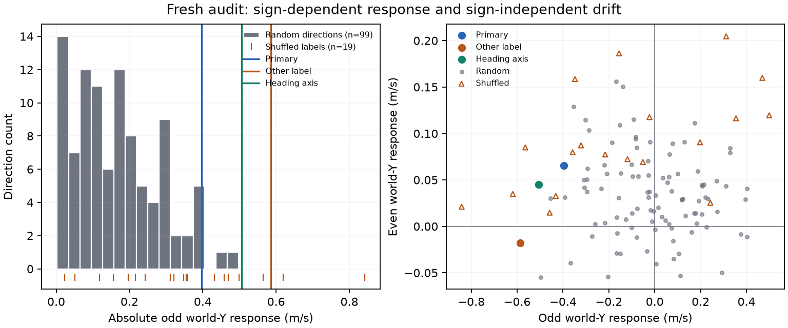

# Independent audit: Ant world-Y path shift

This generated report updates the interpretation and publication of the existing audit, collected under the [pre-collection protocol](ant-classic-005-independent-audit-preregistration.md). The [historical report](https://github.com/BurnyCoder/reinforcement-learning-locomotion-steering-vectors/blob/fc8cf63/reports/ant-classic-005-independent-audit.md), exact [audit JSON](ant-classic-005-independent-audit/audit.json), [directions](ant-classic-005-independent-audit/directions.json), and original logs remain available. No fresh scientific episodes were collected for this publication revision. “Independent” describes the audit's use of raw data rather than preceding audits; it was conducted within this project, not by an external replication laboratory.

## Verdict and evidence boundaries

No error invalidating the original numerical world-Y shift was found in the checks performed. The locked activation intervention produces **+0.402 m/s [0.308, 0.491]** on 30 original confirmation pairs and **+0.462 m/s [0.343, 0.587]** on 20 audit pairs. Original confirmation uses a paired percentile interval; the audit headline uses BCa. The original outcome remains **`confirmation_failed`**. Audit failures rise from 0/20 to 2/20, so the reproduced target effect does not establish acceptable physical quality.

The audit supports a **heading-related perceptual account**, with important limits. Its component ablations and specified observation transformation constrain causal explanations, but do not prove a unique semantic mediator. An arbitrary first-layer activation offset need not correspond to any valid physical observation. In particular, rotating and reclipping already-clipped contact channels is not generally equivalent to observing a physically rotated state.

## Design, chronology and preserved checks

The audit used the previously locked direction and a prespecified strength magnitude; no fresh outcomes were used to retune them. Hypotheses M1/M2 were informed by earlier saved-data inspection, then assessed on a separately collected cohort under fixed rules. There are 251 arms and 5020 recorded episodes on seeds 540000–540019. They include the application cohort previously reserved by convention, which the original integrity check omitted. The new registry records that overlap and rejects reuse for a new application. The formal replication reservation 530000–530029 remains unused.

The historical integrity phase checked vector reconstruction, source identities, paired prefixes, offline actions, chronology, and simulator replays. Its exact counts and tolerances are preserved in `audit.json` under `integrity`. Those checks were reviewed here; this publication build does not independently rerun them. The comparison input files are now hash-pinned, and publication fails on changed or missing identities.

| Cohort | Seeds | Role |
| --- | --- | --- |
| diagnostic | 500000–500015 | observed |
| fit | 501000–501063 | observed |
| validation | 510000–510009 | observed |
| confirmation | 520000–520029 | observed |
| replication | 530000–530029 | unused reservation |
| independent audit | 540000–540019 | observed; includes former application reservation |

## Original-cohort sensitivity

The analysis unit is a paired reset. The recorded estimand averages available post-onset velocities within each episode, retaining a zero summary for the shared pre-onset ending. The following alternative estimands were computed in the historical audit; survivor-only rows are sensitivity descriptions and do not replace the full primary population. Velocity rows use m/s; the displacement row uses metres.

| Saved-data estimand | Pairs | Mean | BCa 95% interval |
| --- | --- | --- | --- |
| recorded | 30 | +0.402 | [0.297, 0.482] |
| excluding prefix only | 29 | +0.416 | [0.311, 0.492] |
| both arms survive | 23 | +0.434 | [0.358, 0.508] |
| y displacement m | 30 | +17.408 | [12.148, 21.334] |

The evaluated alternative estimands retain a positive effect. That is narrower than asserting that every reasonable estimand must do so. Paired designs do not automatically reduce variance, and uncertainty must follow the actual pairing and shared-baseline structure. The [path-mechanism audit](ant-classic-005-mechanism-audit.md) retains the corresponding correlation and joint-bootstrap evidence.

## Fresh audit: targets, controls and ablations

| Audit arm | Δ world-Y m/s | 95% interval | Forward speed retained | Squared-action change | Failures |
| --- | --- | --- | --- | --- | --- |
| baseline | +0.000 | reference | 100.00% | +0.00% | 0/20 |
| lateral -0.1000 | +0.462 | [0.343, 0.587] | 96.40% | +17.40% | 2/20 |
| lateral +0.1000 | -0.331 | [-0.426, -0.237] | 96.04% | -9.36% | 2/20 |
| turning -0.1000 | +0.568 | [0.438, 0.684] | 96.50% | +6.83% | 1/20 |
| turning +0.1000 | -0.604 | [-0.696, -0.511] | 97.07% | -0.81% | 0/20 |
| heading_parallel -0.1000 | +0.570 | [0.485, 0.666] | 98.55% | +1.60% | 4/20 |
| heading_parallel +0.1000 | -0.471 | [-0.547, -0.391] | 98.66% | +2.27% | 1/20 |
| heading_orthogonal -0.1000 | +0.010 | [-0.098, 0.116] | 98.76% | +16.62% | 2/20 |
| heading_orthogonal +0.1000 | +0.136 | [0.041, 0.228] | 95.93% | -11.13% | 2/20 |
| heading_orthogonal_renorm -0.1000 | -0.131 | [-0.311, 0.062] | 81.44% | +47.09% | 8/20 |
| heading_orthogonal_renorm +0.1000 | +0.435 | [0.299, 0.567] | 79.71% | -9.98% | 14/20 |
| heading_axis_renorm -0.1000 | +0.551 | [0.444, 0.654] | 98.79% | +0.80% | 2/20 |
| heading_axis_renorm +0.1000 | -0.461 | [-0.555, -0.367] | 99.61% | +1.38% | 2/20 |
| perceived_heading -0.160876rad | +0.903 | [0.816, 0.998] | 97.50% | +0.24% | 0/20 |
| perceived_heading +0.160876rad | -0.913 | [-0.999, -0.818] | 98.96% | +1.04% | 0/20 |

The locked primary and perception-arm intervals are the saved paired BCa intervals where available. Other displayed arm intervals are explicitly descriptive percentile intervals generated from the saved pairs; their exact methods and resampling seeds are in [evidence.json](ant-publication/evidence.json). They create no new acceptance decisions or selections. All 99 random directions and 19 shuffled-label redraws, at both signs, remain available in the [explorer](https://BurnyCoder.github.io/reinforcement-learning-locomotion-steering-vectors/) and downloadable evidence, including failed arms.

| Test | Saved statistic | Interpretation |
| --- | --- | --- |
| P1: locked arm | +0.462 [0.343, 0.587] m/s | effect reproduced; physical gate fails |
| P2: isotropic comparison | comparison rank = 0.05 | descriptive ensemble ranking |
| S1: label specificity | shuffle rank = 0.40 | not supported; turning is stronger |
| S2: generic drift | +0.034 [-0.032, 0.104] m/s | interval includes zero |
| M1: component ablation | orthogonal norm-matched comparison rank = 0.21 | original falsification criterion not met |
| M2: observation transform | +0.903 [0.816, 0.998] m/s at negative rotation | specified transform produces a shift; not exact physical-heading equivalence |

For P1 the saved Monte Carlo estimate is **p = 0.00019998**, at the procedure's floor with 10000 sampled sign patterns. A floor estimate is not an upper confidence bound on the exact randomization p-value. Exact sign-flip calibration additionally requires symmetry under the sign changes; a zero mean alone is insufficient. The original decisions are unchanged. P2 describes the recorded random ensemble; it does not establish lateral-label specificity. The stronger turning-label vector and shuffled redraws also do not support that claim.

These ranks describe comparisons with the specified control ensembles. Treating them as calibrated p-values requires exchangeability under an explicit null; norm matching alone does not make a label-derived, selected primary exchangeable with random directions. See [statistical assumptions](https://github.com/BurnyCoder/reinforcement-learning-locomotion-steering-vectors/blob/main/docs/methodology.md#statistical-assumptions-and-rank-interpretation).

## Odd/even responses and mechanism

For each magnitude, let f(α) be the treated-minus-baseline world-Y response. The odd part is `(f(+α) - f(-α))/2`; the even part is `(f(+α) + f(-α))/2`. The odd part measures sign dependence, while the even part can include generic drift. These parts do not by themselves name an internal concept.

| Direction | Odd world-Y m/s | Even world-Y m/s | Failures − / + |
| --- | --- | --- | --- |
| lateral | -0.397 | +0.066 | 2 / 2 |
| turning | -0.586 | -0.018 | 1 / 0 |
| heading_parallel | -0.520 | +0.049 | 4 / 1 |
| heading_orthogonal | +0.063 | +0.073 | 2 / 2 |
| heading_orthogonal_renorm | +0.283 | +0.152 | 8 / 14 |
| heading_axis_renorm | -0.506 | +0.045 | 2 / 2 |

The observation arm at negative 9.22 degrees produces **+0.903 m/s [0.816, 0.998]**, with 20 positive pairs. It changes the quaternion, world linear velocity, and already-clipped world-oriented contact wrenches seen by the actor, leaving simulator state unchanged. The operational transform is `clip(R clip(f))` for contact channels. The pinned [Ant observation code](https://github.com/Farama-Foundation/Gymnasium/blob/v1.0.0/gymnasium/envs/mujoco/ant_v5.py) clips before the proxy receives the observation; a physical rotation would require `clip(R f)` from the unavailable unclipped wrench.

The existing physical-frame test scales forces into an unsaturated regime. It establishes coordinate-frame handling there, not general equivalence. A new deterministic saturated-wrench counterexample covers that boundary without changing the comparator. The following counts are a post hoc descriptive analysis of saved states, with one state counted when any planar wrench component is at a clipping bound:

| Saved cohort | States with clipped planar wrench component | Post-onset states | Pooled fraction |
| --- | --- | --- | --- |
| fitting | 8444 | 53409 | 15.81% |
| audit baseline | 2801 | 18000 | 15.56% |

These counts show the unsaturated assumption is not universal; they do not measure how much of the behavioral effect is caused by clipped contact channels. A new intervention would be needed for that causal distinction. The exploratory projection model's limited predictive success also remains in the saved E1 results; it is not omitted to favor the heading interpretation.

## Path kinematics

These historical summaries use steps both arms recorded. They have their own eligible-pair counts and do not replace the all-pair primary estimand. Travel direction is derived from displacement; agreement between those two quantities is arithmetic, not independent mechanism evidence.

| Arm | Pairs | Δ world-Y m/s | Δ travel angle degrees | Δ torso yaw degrees |
| --- | --- | --- | --- | --- |
| original confirmation | 27 | +0.403 | +3.66 | +4.90 |
| primary_minus | 20 | +0.452 | +4.19 | +5.48 |
| perception_minus_delta | 20 | +0.903 | +8.10 | +7.83 |
| heading_parallel_minus | 20 | +0.559 | +4.99 | +5.08 |

The recorded path and torso headings change over the observed horizons. These finite trajectories and their fitted window trends do not establish that the offset remains bounded at longer horizons or that turning has ceased. They support heading involvement without identifying a unique mechanism, rigid gait rotation, or a body-relative sideways command. The [kinematics follow-up](fact-check-2026-10-29/kinematics-follow-up.md) documents angle and trend conventions and their boundary-case corrections.

## Learnings, failure history and limits

The original audit first reconstructed the evidence chain because numerical agreement is meaningful only when the interventions and pairing are authentic. It expanded the random-direction comparison because a small control set cannot resolve a useful rank test. The component ablations and observation comparator test causal predictions beyond correlation, but the clipping caveat shows why the precise intervention matters.

The first historical collection attempt encountered a MuJoCo memory-allocation failure and resumed with fewer workers; the original complete logs retain that failure and retry. The source's version-pinned behavior and saved episode identities are the evidence for resumption. We do not infer that worker count can never affect any future workload. Additional build/test failures and fixes for this revision are recorded in the [completion ledger](../docs/ant-publication.md).

Only one checkpoint and simulator are represented. Training-seed generalization, real-robot transfer, fresh strength-magnitude sensitivity, covariance-shaped nulls beyond the tested shuffles, formal replication, and practical target control remain unestablished. The original random and shuffled directions, all unsuccessful episodes and original gate decisions remain unchanged. No training-loss curve is available because this project did not train the evaluated policy.

## Reproduction and sources

Run `uv run --locked --no-sync python scripts/build_ant_publication.py` after the repository's locked installation. The command restores missing pinned evidence and regenerates this report, its PDF, tables, figures and explorer without loading a policy or running a simulator. Add `--check` to detect stale outputs. The [input manifest](ant-publication/inputs.json) records every local path, Hub path, byte hash and immutable revision. Historical simulator reproduction requires the historical code revision and its unchanged cache identities; do not rewrite an old manifest to bypass identity checks.

Related work: [maze-policy activation interventions](https://arxiv.org/abs/2310.08043), [top-right steering](https://turntrout.com/top-right-steering-vector), [contrastive activation addition](https://arxiv.org/abs/2312.06681). Statistical implementations: [SciPy bootstrap](https://docs.scipy.org/doc/scipy-1.14.1/reference/generated/scipy.stats.bootstrap.html), [permutation testing](https://docs.scipy.org/doc/scipy-1.14.1/reference/generated/scipy.stats.permutation_test.html), [Phipson and Smyth](https://doi.org/10.2202/1544-6115.1585), and [Holm](https://www.jstor.org/stable/4615733). Source adaptations and unresolved license information are recorded in [sources](../docs/sources.md).
