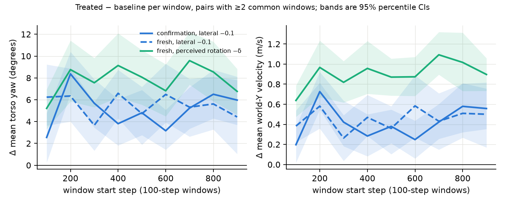
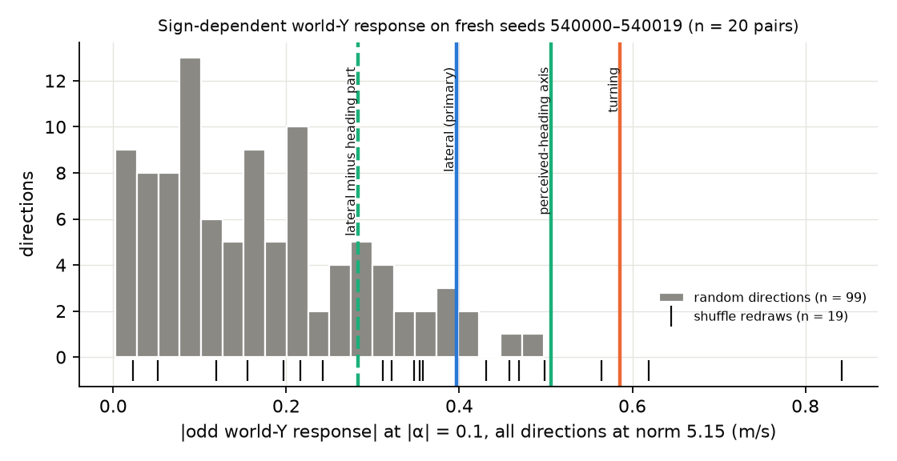
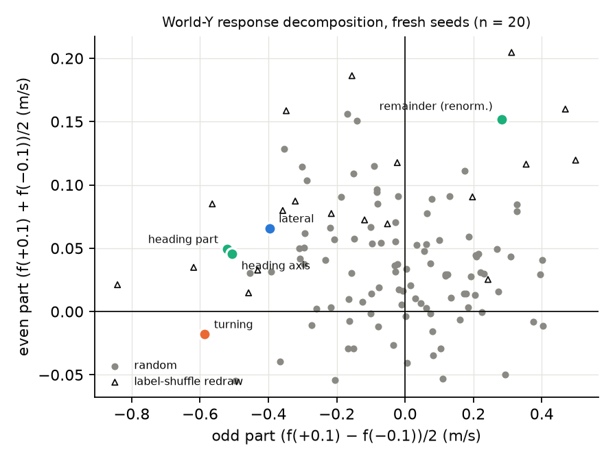

# Independent audit: Ant 005 world-+Y path shift from the "lateral" steering vector

Audit date 2026-10-16. Scope: the featured claim that adding the saved `lateral` vector at α = −0.1 after the frozen Ant SAC actor's first ReLU moves the ground path toward world +Y (+0.402 m/s [0.308, 0.491] on 30 confirmation pairs). The audit did not read or use the earlier audits. Its evidence comes from the raw episodes in `runs/ant-classic-005/episodes`, the source code, and 5,020 new episodes on fresh seeds. Those episodes were collected under a [protocol pushed beforehand](ant-classic-005-independent-audit-preregistration.md) (commit `ea11e75`, 14:25:40 UTC). The audit run started at 14:25:59 UTC, and its first fresh-seed episode was logged at 14:26:32 UTC. Machine-readable results are in [`audit.json`](ant-classic-005-independent-audit/audit.json), the treatments in [`directions.npz`](ant-classic-005-independent-audit/directions.npz), and complete timestamped logs sit in the same folder.

## Verdict

No error invalidates the causal finding. The world-+Y shift is real, correctly measured and correctly reported, and it replicates on fresh resets. Its **interpretation needs one correction**: the vector does not encode a motor command to go sideways. It is a perceived-heading direction. Adding it at −0.1 makes the policy perceive a heading rotated toward −Y, and its own heading correction then turns the real path toward +Y.

| Claim | Verdict | Evidence |
| --- | --- | --- |
| Causal world-Y increase at lateral −0.1 | **Sound, replicated** | Fresh seeds: +0.462 m/s, BCa 95% CI [0.343, 0.587], 19/20 pairs positive, sign-flip p < 0.001 (P1) |
| Published numbers (README featured section) | **Accurate** | 11 of 11 recomputed from raw episodes; all 94 saved effects and intervals reproduce exactly |
| Implementation, pairing, leakage, chronology | **No defect found** | Bitwise vector refit, matched prefixes, exact re-simulation, selection locked before confirmation |
| Path change is a rotated path, not a sidestep toward +Y or a continuing turn | **Correct** | Torso heading +5.5°, travel direction +4.2°, no yaw trend (fresh); gait-axis velocity even drifts slightly toward −Y (−0.115 m/s) |
| Better than a generic perturbation of equal size | **Borderline** | Rank p = 0.05 among 99 isotropic random directions; 4 of 99 match or exceed it (P2) |
| Specific to the lateral label | **Not supported** | The turning vector is stronger; 7 of 19 label-shuffle redraws match or exceed it (S1) |
| Mechanism | **Perceived heading (new, supported)** | cos(lateral, g) = 0.914. The heading component carries the effect (M1), and rotating the observation alone reproduces it with zero failures (M2) |
| Generic drift toward +Y under any perturbation | **Not supported at \|α\| = 0.1** | Mean sign-independent part over 99 random directions: +0.034 [−0.032, +0.104] m/s (S2) |
| Physical cost | **Unchanged conclusion; gate fails again** | Fresh seeds: 2/20 treated failures vs 0/20 baseline. This is typical of equal-size random perturbations (mean 1.8–2.3/20) |

## 1. Integrity of the saved evidence

All checks below ran on saved data (phase `verify_integrity`), and all passed.

| Check | Result |
| --- | --- |
| Seed splits (diagnostic, fitting, validation, confirmation, replication, audit) | Disjoint. The check covered recorded splits only; the audit seeds include the run's convention-reserved application cohort 540000–540009 (see §7) |
| Refit all ten vectors with the production estimator on the 64 fitting episodes | Bitwise identical to `vectors.npz` |
| Independent reimplementation of the lateral contrast from the written rule | Max abs difference 5.5×10⁻⁸; cosine 1.000000 |
| Saved fitting activations vs offline first-ReLU evaluation of saved observations | Max abs difference 1.4×10⁻⁶ |
| Confirmation identity files: treatment hash, strength, policy hash, runtime source | All six arms match the locked selection |
| Matched prefixes: onset state hash and actions of steps 0–99 | Equal in 880/880 validation and 180/180 confirmation pairs |
| First treated action differs exactly at step 100 | 880/880 and 174/174 (the 6 others are the shared step-34 failure) |
| Offline rebuild of treated actions from saved observations plus the hook | Max abs difference 1.2×10⁻⁵ (float32 batch vs single); one hook call per forward pass; the two ReLU modules are distinct objects |
| Clean-process re-simulation of seeds 520000, 520010, 520025 in both arms | Every saved array identical (max abs difference 0) |
| Chronology | Fitting ended 23:57:07; validation 00:02:54–00:09:03; selection locked 00:09:03.020; first confirmation episode 00:09:04 UTC |

The hook adds the vector after `actor.latent_pi[1]` exactly once per forward pass, and only from step 100. Nothing else in the policy or environment changes. The vector comes only from fitting episodes. The selected strength comes only from validation episodes.

## 2. Accuracy of the published numbers

| README claim | Stated | Recomputed |
| --- | --- | --- |
| World-Y effect | +0.402 m/s | +0.40238 |
| 95% interval | [0.308, 0.491] | [0.30803, 0.49127] |
| Forward-speed retention | 96.83% | 96.827% |
| Failures, baseline / steered | 4/30, 4/30 | 4/30, 4/30 |
| Mean squared action change | +17.84% | +17.837% |
| Original reward decreases | yes | Mean episode return 5,821.7 → 5,558.0 |
| Random-direction controls | +0.15 to +0.25 m/s | +0.155, +0.253, +0.155 |
| Primary minus each random control and the action bias | 0.15–0.27 m/s | 0.150, 0.247, 0.248, 0.268 |
| Shuffled-label control | +0.89 m/s, 9/30 failures | +0.890, 9/30 |
| Shuffled–primary alignment | cosine 0.60 | cosine 0.599 |

The recomputation also reproduces all 88 validation and 6 confirmation effects and intervals with zero difference. It summarizes episodes independently and replicates the original bootstrap draws.

## 3. Robustness of the confirmation effect

| Estimand (30 confirmation pairs unless stated) | Mean | BCa 95% CI | Pairs + / − |
| --- | --- | --- | --- |
| Recorded: mean post-onset world-Y velocity, zero for an episode ending before onset | +0.402 m/s | [0.297, 0.482] | 28 / 1 |
| Excluding the shared step-34 pair (n = 29) | +0.416 m/s | [0.311, 0.492] | 28 / 1 |
| Pairs where neither arm fails (n = 23) | +0.434 m/s | [0.358, 0.508] | 23 / 0 |
| Common horizon only (pairs with ≥ 200 shared steps, n = 27) | +0.403 m/s | [0.285, 0.477] | 26 / 1 |
| Post-onset world-Y displacement | +17.4 m | [12.1, 21.3] | 27 / 2 |

The 10% trimmed mean is +0.424 m/s. Leave-one-out means stay within [0.388, 0.431]. The Wilcoxon signed-rank p is 6×10⁻⁷. Pairing does not reduce variance: the arm correlation is r = −0.18 over all pairs and −0.40 without the shared pre-onset pair. The paired-difference variance is 1.16 times the unpaired sum, so the interval is not optimistic. No reasonable estimand removes the effect.

## 4. What the ground path does

The quantities below are treated-minus-baseline over the steps both arms recorded. Torso yaw comes from the observed quaternion. Travel direction is the angle of net displacement. Gait-axis lateral velocity is the velocity across the torso heading, offset by the baseline's torso-to-path angle. That angle is about 44° for this gait, so the raw torso frame cannot be used directly.

| Arm (pairs) | Δ world-Y (m/s) | Δ travel direction | Δ torso yaw | Δ gait-axis lateral (m/s) | Yaw trend per 100 steps |
| --- | --- | --- | --- | --- | --- |
| Confirmation, lateral −0.1 (27) | +0.403 [0.285, 0.477] | +3.66° [2.62, 4.32] | +4.90° [3.87, 5.73] | −0.125 [−0.177, −0.079] | −0.16° [−0.66, 0.16] |
| Fresh, lateral −0.1 (20) | +0.452 [0.338, 0.579] | +4.19° [3.14, 5.28] | +5.48° [4.30, 6.62] | −0.115 [−0.147, −0.071] | −0.10° [−0.36, 0.17] |
| Fresh, heading component only (20) | +0.559 [0.482, 0.659] | +4.99° [4.31, 5.87] | +5.08° [4.16, 6.20] | +0.030 [−0.024, 0.086] | +0.09° [−0.49, 1.20] |
| Fresh, perceived rotation −9.2° (20) | +0.903 [0.816, 0.998] | +8.10° [7.37, 8.92] | +7.83° [6.74, 8.98] | +0.015 [−0.035, 0.073] | +0.12° [−0.15, 0.40] |

The heading settles to a bounded offset within the first 100–200 steps after onset and has no trend afterwards, so this is not a continuing turn. The forward gait carries a rotated heading, which tilts the path toward +Y. Under the full lateral vector, the torso turns about 1.3° more than the path. That small crab against the gait axis comes from the vector's remainder: the pure heading component and the observation rotation both rotate the path rigidly, with gait-axis lateral velocity indistinguishable from zero.

## 5. Fresh-seed experiment

Seeds 540000–540019 belong to no recorded split and had never been run. Seeds 540000–540009 are, however, the application cohort that `demonstrate` reserves by convention for this run (seed offset 500000 + 40000), so a future 005 application must use other seeds (§7). The design ran 124 directions at α = ±0.1, plus ±δ_eq perception arms and one shared baseline: 251 arms and 5,020 episodes, all deterministic, with onset at step 100 and a 1,000-step horizon. The unit is one reset. f is treated-minus-baseline mean post-onset world-Y velocity. The odd part is (f(+0.1) − f(−0.1))/2 and the even part is (f(+0.1) + f(−0.1))/2. The pre-registered decisions are:

| ID | Pre-registered test | Result | Decision |
| --- | --- | --- | --- |
| P1 | Lateral −0.1 replicates | +0.462 m/s [0.343, 0.587]; 19/20 positive; sign-flip p ≤ 2×10⁻⁴ (Monte Carlo floor); Wilcoxon p = 4×10⁻⁶; speed retention 96.4% | **Not falsified** (Holm p = 4×10⁻⁴) |
| P2 | Lateral \|odd\| vs 99 isotropic directions of equal norm | \|odd\| = 0.397 [0.351, 0.437]; random quantiles 50/90/95/99% = 0.152 / 0.327 / 0.393 / 0.456; 4 random directions ≥ lateral | Rank p = 0.05; Holm-adjusted 0.05. **Not falsified, but exactly at the threshold** |
| S1 | Label specificity | turning \|odd\| 0.586, larger by 0.19 (joint-seed 95% CI 0.12–0.26); 7 of 19 shuffle redraws ≥ lateral (rank p = 0.40) | **Not label-specific** |
| S2 | Generic even part, 99 random directions | +0.034 [−0.032, +0.104] m/s; odd-part sanity mean −0.009 [−0.048, +0.032] | No detectable generic +Y drift; sanity check passes |
| M1 | Perceived-heading component carries the effect | heading part odd −0.520 (lateral −0.397); remainder odd +0.063; additivity gap CI [−0.127, +0.007]; remainder at full norm ranks p = 0.21 among random; pure heading axis at full norm odd −0.506, rank p = 0.01 | **Not falsified** |
| M2 | Rotate only the observation by ∓9.22° (no activation edit) | −δ: +0.904 [0.816, 0.998], 20/20 pairs; +δ: −0.913 [−0.999, −0.818], 20/20; odd −0.908 [−0.948, −0.866]; even −0.005; 0/20 failures in both arms | **Supported** |

The best-arm comparison is a secondary, conservative check. It credits each random direction with its better sign and compares that against the locked arm, giving rank p = 0.03.

## 6. Mechanism: why a "lateral" vector rotates the path

The first actor layer is a function of the current observation only, so any contrast vector there is a signature of observed state. This policy travels forward at about 6.3 m/s. At that speed, a heading error θ moves the body at about 6.3·sin θ m/s along world Y. Windows with high world-Y velocity are therefore mostly windows whose observed heading points toward +Y. The quartile contrast recovers that perceived-heading direction: cos(lateral, g) = 0.914, where g is the first-ReLU response to rotating the observed world.

The policy was trained to run along +X and corrects its heading. Adding +α·lateral reports a heading rotated toward +Y, so the policy steers toward −Y; −α reports −Y, so it steers toward +Y. This accounts for the observed sign reversal relative to the label, the bounded heading offset, the heading component's sufficiency (M1), and the rigid path rotation produced by perception alone (M2).

Rotating perception by −9.2° changes the real torso heading by +7.8° and the travel direction by +8.1° (§4). The policy thus compensates for most of a perceived offset. The equal-size activation edit changes them by only +5.5° and +4.2°. The linearized equivalence δ_eq therefore overstates the vector's perceived rotation by 1.4–1.9× when measured by heading, and by 2.3× when measured by the odd world-Y response (0.908 vs 0.397). The turning vector acts mainly through perceived yaw rate: cos 0.74 with the ω_z gradient, 0.05 with g.

**E1 (exploratory).** A linear model with projections onto g and the ω_z gradient does not predict random directions' responses: leave-one-out R² = −0.01. Isotropic directions barely project onto these axes (projection SD ≈ 0.32, vs 4.7 for lateral), so their responses come from elsewhere. The model predicts turning's response closely (−0.599 vs −0.586 observed). It underpredicts the heading directions, because the g coefficient is not identified from random data (bootstrap CI [−0.12, +0.16]). This is reported as exploratory, not evidence.

## 7. Deviations, limitations and remaining threats

**Deviations from the protocol.** The first full run used 12 workers and stopped after 300 episodes because MuJoCo could not allocate memory: about 5.5 GB of RAM was free and the page file was limited by a nearly full disk. The run resumed with 6 workers. Episodes are deterministic per seed, as the bit-identical re-simulation shows, and completed files were kept. The worker count cannot change any result.

**Reserved-seed overlap (found in the 2026-10-22 [fact-check](fact-check-2026-10-22.md)).** `demonstrate` reserves seeds `seed_offset + 40000` onward for a run's application cohort (`fresh_application_seeds` in `demonstration.py`), which is 540000–540009 for Ant 005. The audit's fresh seeds include them. Its integrity check covered only recorded splits, and the application cohort is not recorded in the manifest, so the overlap went unnoticed. The audit results are unaffected, but those resets are no longer fresh for an Ant 005 application, which would need another cohort.

**Gaps.** The methodology recommends covariance-shaped random directions. Here the 19 shuffle redraws are the only data-shaped null, and they span cosines −0.37 to +0.83 with the primary. The original control's 0.60 was one draw.

**Limitations.**
- One pretrained checkpoint and one simulator were tested, so generality across training seeds or policies is unknown.
- Only |α| = 0.1 was tested on fresh seeds, with n = 20 resets.
- M1 and M2 were formed after inspecting saved data (validation odd/even parts, confirmation kinematics, the offline cosine with g). They were then tested on fresh seeds under fixed decision rules.
- P2's p = 0.05 is at the decision boundary. A different random draw could move it either way, so specificity against generic directions is weak.

**Post hoc analyses (labelled as such).** These are the failure-rate comparison with random arms, the shuffled redraws' cosine range, and the E1 coefficient interval. The fresh primary arm would also fail the production quality gate on failures: +10 percentage points, 2 vs 0 of 20. That is no worse than random perturbations of the same size. The perception arms had no failures.

## 8. Learnings

**What was tried and why.**
- The audit first rebuilt the evidence chain end to end: refit, hashes, prefixes, offline action reconstruction and re-simulation. An implementation error would make every statistic moot, and saved data allow exact checks.
- Every published number was recomputed with an independent summarizer. A test checks that it matches the production estimand.
- The kinematics were decomposed because world-Y velocity at 6.3 m/s forward speed is dominated by heading. A torso frame alone misleads, because this gait runs about 44° off the torso axis.
- The sign reversal suggested a perceptual rather than motor direction. The decisive test is an intervention, not a correlation. The perception arm removes the activation edit entirely and still reproduces the effect, while the heading-component ablation shows what the vector carries.
- Random-direction specificity needed many more than three draws. With 99 draws the rank-p resolution is 0.01.

**Issues and fixes.**
- `uv add scipy` failed while replacing the locked editable install. Adding with `--no-sync` and syncing without reinstalling the project fixed it.
- The physical-rotation test established the frames empirically with `mj_objectVelocity`. The free joint's linear velocity is world-frame and its angular velocity body-frame; cfrc_ext is world-oriented. The MuJoCo pages fetched for this audit did not state the free-joint velocity frames, but the [MuJoCo 3.1.5 overview](https://mujoco.readthedocs.io/en/3.1.5/overview.html#floating-objects) does and agrees with the empirical result.
- The memory failure was fixed by lowering the worker count.
- Figure labels overlapped and were re-placed after visual inspection.

**What the result means.** The steering vector works by changing what the policy believes about its heading. This is a coherent causal account and it is testable. It is not evidence for a sideways-motion concept.

## 9. Reproduction

Use the documented setup (`uv sync`), with the original run present in `runs/ant-classic-005`. Pass `--workers` according to available memory; results do not depend on it.

- Saved-data phases only: `uv run --no-sync python scripts/audit_ant005_independent.py --stop-after directions`
- Full audit with fresh seeds: `uv run --no-sync python scripts/audit_ant005_independent.py --workers 6`

Tests: `uv run --no-sync pytest tests/test_perception.py tests/test_specificity.py tests/test_kinematics.py tests/test_independent_audit.py`. Fresh episodes go to `runs/ant-005-independent-audit` (about 1.5 GB, not committed). The input hashes are in [`input-identities.json`](ant-classic-005-independent-audit/input-identities.json).

## Sources

- [Gymnasium Ant-v5 observation construction](https://github.com/Farama-Foundation/Gymnasium/blob/v1.0.0/gymnasium/envs/mujoco/ant_v5.py)
- [MuJoCo computation chapter (c-frame quantities)](https://mujoco.readthedocs.io/en/3.1.5/computation/index.html)
- [mjData field layout](https://mujoco.readthedocs.io/en/3.1.5/APIreference/APItypes.html)
- Rank p-values: [Phipson & Smyth 2010](https://doi.org/10.2202/1544-6115.1585)
- [Holm 1979](https://www.jstor.org/stable/4615733)
- SciPy 1.14 [`bootstrap`](https://docs.scipy.org/doc/scipy-1.14.1/reference/generated/scipy.stats.bootstrap.html) and [`permutation_test`](https://docs.scipy.org/doc/scipy-1.14.1/reference/generated/scipy.stats.permutation_test.html)
- [Contrastive activation addition](https://arxiv.org/abs/2312.06681)
