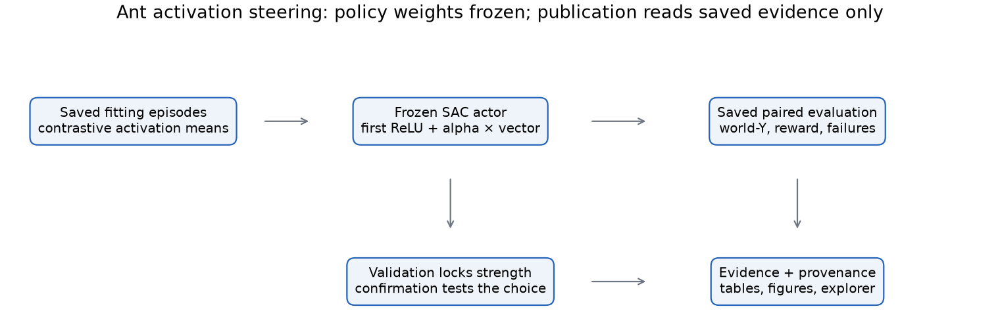
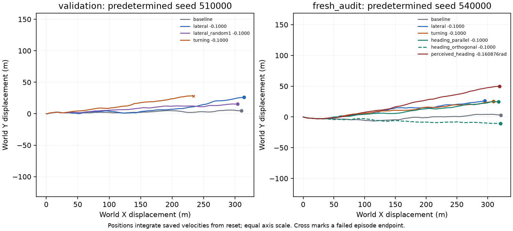

# Causal activation steering in frozen RL locomotion policies

**Featured result: Ant lateral steering on fresh episodes, alongside four earlier HalfCheetah experiments**

Author: Libor “Burny” Burian

Evidence cutoff: **2026-09-08, after experiments 001–005 completed their recorded numerical stages**. Reanalyses dated 2026-10-16, one with fresh seeds [E9], qualify Sections 4, 6 and 8; a 2026-10-22 fact-check [E10] and the earlier [documentation audit](https://github.com/BurnyCoder/reinforcement-learning-locomotion-steering-vectors/blob/main/reports/documentation-audit.md) correct wording and provenance without changing any recorded number. This is a research snapshot, not a peer-reviewed publication; numerical results and protocol decisions are preserved in the accompanying experiment reports.

## Abstract

We investigate whether a constant hidden-activation intervention can alter locomotion in a frozen reinforcement-learning policy without behavioral cloning or weight updates. Earlier HalfCheetah attempts produced posture changes and slowdowns but did not establish a useful replicated controller. The featured Ant experiment extracts an episode-weighted difference of activation means from natural world-Y velocity variation and selects intervention strength on separate validation episodes. The locked strength -0.1 changes world-Y ground-plane velocity by +0.402 m/s, paired percentile-bootstrap 95% interval [0.308, 0.491], on 30 confirmation pairs, retaining 96.83% of mean forward speed. Its status remains `confirmation_failed`: both arms have 4/30 failures and a shared pre-onset ending triggers a strict rejection rule. A later audit reproduces +0.462 m/s [0.343, 0.587] on 20 further resets, while failures increase from 0 to 2. Its sign-dependent response ranks at p = 0.05 against 99 isotropic directions; lateral-label specificity is not supported. Projection ablations and an observation intervention support a heading-related explanation, but clipping prevents general physical-heading equivalence. We publish the positive effect, failed quality gates, complete controls, raw episodes, and a saved-data publication workflow. The evidence is specific to the evaluated checkpoint and simulator; cross-training-seed generalization remains untested. [E5, E9; generated values from the accompanying evidence bundle.]

## 1. Research question and scope

The objective is to find an interesting, useful causal change in RL locomotion, not to require a particular speed effect or an internal concept with a predetermined name. Contrastive activation addition (CAA) offers an existing construction based on differences of hidden means [R1]; Baukit supplies reusable PyTorch intervention hooks [R2]. We adapt those components to continuous control and physical measurements. We do not claim novelty of activation steering, a complete literature comparison, or that the original language-model findings validate locomotion control.

| Policy used | Verified actor and interface | Upstream training record |
| --- | --- | --- |
| HalfCheetah-v5 TQC medium | Two 256-unit ReLU hidden layers; 17 observations, 6 actions | Saved seed 0; 5,920,000 recorded environment timesteps |
| Ant-v5 SAC medium | Two 256-unit ReLU hidden layers; 105 observations, 8 actions | Saved seed 0; 8,770,000 recorded environment timesteps |

Both checkpoints are public Farama-Minari releases [R3, R4]. Training seed and step counts were read from their ZIP metadata without executing serialized objects. Saved optimizer settings include learning rate 0.0003, discount 0.99, batch size 256, and replay capacity 1,000,000; these are provenance, not hyperparameters tuned here. Curriculum, full learning curves, and upstream training history were not independently reproduced. There was **no local policy training, fine-tuning, action-demonstration fitting, or behavioral cloning**. Each environment is represented by one evaluated checkpoint; many evaluation resets do not establish generalization across separately trained policies.

<!-- pagebreak -->

## 2. Methods: data and interventions

### 2.1 Frozen inference and behavioral measurements

The actor maps observations to bounded continuous motor actions. We intervene at `actor.latent_pi[1]`, the first ReLU of the verified architecture, leaving all learned parameters fixed. The rule is `h_new = h + alpha * d_scaled`, applied after a common 100-step unsteered prefix. A later nonlinear layer makes state-dependent action effects possible. Every episode runs for at most 1,000 steps; the simulator control timestep is 0.05 seconds. Model revision, file hash, parameter hash, software versions, environment interface and selected layer are recorded per run.

Measured targets are forward velocity (m/s), lateral velocity on the ground (m/s), mean torso height (m), yaw rate (rad/s), and an effort proxy: mean squared normalized actions. Lateral is the world's ground-plane y velocity; it does not establish body-frame sidestepping or jumping. Forward-speed retention is a ratio of episode-averaged speeds, not retained distance traveled or full-horizon completion. The effort proxy is not motor energy, work, or battery consumption. Turning uses quaternion-derived orientation with wrapped angle differences; no quaternion coordinate is treated as an angle. Original reward, action saturation, inversion, inappropriate ground contact and episode failure are recorded alongside target effects [R5, R6].

### 2.2 Contrastive extraction

Each new fitting study starts with 16 stochastic diagnostic episodes and 64 stochastic fitting episodes. Full, non-overlapping 100-step windows after startup provide local variation even when whole-episode behavior is nearly constant. Nonfinite windows and windows exceeding 5% inversion or forbidden head/torso-ground contact are excluded from fitting with recorded counts. Short tails do not supply incomplete windows. Failed evaluation episodes are never removed to improve results.

Upper and lower behavior quartiles define the contrast groups. Each group must have at least eight independent contributing episodes. Window contributions are averaged within episode before averaging episodes, so long or frequent contributions do not become extra independent observations. The raw direction is `d_raw = mean(h_high) - mean(h_low)`. Effort contrasts are formed within up to five forward-speed bins, with equal bin weighting; residual confounding remains possible. Quartile gaps and vector norms must exceed small numerical tolerances before normalization.

The direction's norm is scaled using `S = sqrt(E_fit[||h - mean(h)||_2^2])` and `d_scaled = S * d_raw / ||d_raw||_2`. This is the centered vector-norm RMS, with no division by hidden dimension. The expectation uses eligible timesteps, including within-window variation, with equal episode weighting. Alpha is relative to this source activation scale, not a physical-unit command. Split-half cosine and fitting sensitivity diagnose extraction stability; they do not prove causal effectiveness.

Experiment 001 used health-only eligibility. Following fitting-only sensitivity analysis, 002 added a forward-speed floor: retain finite healthy fitting windows strictly above half their median forward speed. This 0.5 fraction is a project pilot heuristic. It excluded no additional windows in the fresh 002 or 005 samples, so their results cannot be attributed empirically to the floor removing observations in those samples. Experiments 003 and 004 reuse the exact 002 height family and fitting evidence without refitting; only the evaluated target and fresh evaluation partitions change.

### 2.3 Controls and treatment identity

Each fitted primary family in these studies has three random directions and a shuffled-label direction, all matched in norm and given the same validation strength grid. The general extraction procedure can skip a shuffled contrast that fails eligibility checks; no missing control is silently counted as evaluated. When a primary candidate qualifies, a constant action-bias comparator is fitted using every tenth post-startup source observation. It averages steered-minus-baseline deterministic actions at the selected hidden strength and divides by the largest absolute comparator-grid strength. Multiplication by that positive magnitude reproduces the fitted mean displacement before runtime clipping. This is a fixed action offset, not a learned imitation policy. Exact vectors, control provenance, action biases and source mappings remain saved. In retargeted runs, an alias such as `speed` can denote a height-derived array; the original extraction label remains explicit. The [bias construction](https://github.com/BurnyCoder/reinforcement-learning-locomotion-steering-vectors/blob/main/src/rl_locomotion_steering_vectors/experiment.py#L72) records its normalization.

<!-- pagebreak -->

## 3. Evaluation, acceptance and adaptive chronology

Evaluation uses deterministic actions and paired reset seeds. Each pair reaching intervention must have matching complete simulator-state hashes at onset. Per-episode summaries average available post-onset steps; all planned pairs remain in the estimator. Prefix-only episodes receive zero behavioral summaries but still count as failures. Effects are equal-weight means of paired episode differences, not pooled timestep averages or fixed-horizon travel. Confidence intervals use 2,000 percentile-bootstrap resamples of paired episodes; seeds are 710 for validation and 720 for confirmation. Intervals are nominal, with no correction for the many exploratory conditions. The [summary implementation](https://github.com/BurnyCoder/reinforcement-learning-locomotion-steering-vectors/blob/main/src/rl_locomotion_steering_vectors/analysis.py#L194) defines these conventions.

The [implemented target gates](https://github.com/BurnyCoder/reinforcement-learning-locomotion-steering-vectors/blob/main/src/rl_locomotion_steering_vectors/analysis.py) define the following project thresholds; library defaults do not supply these usefulness criteria.

| Target | Practical change threshold | Movement preservation |
| --- | --- | --- |
| Forward speed | At least 5% absolute change | At least 50% baseline forward speed |
| Effort proxy | At least 10% reduction | Forward speed within 5% of baseline |
| Torso height | At least 0.03 m absolute change | Forward speed within 10% of baseline |
| Lateral velocity | At least 0.2 m/s absolute change | At least 80% baseline forward speed |
| Yaw rate | At least 0.1 rad/s absolute change | At least 80% baseline planar speed |

All targets also require an interval excluding zero and quality acceptance. The quality-increase rule permits at most five percentage points additional failure, inversion, or forbidden contact. After the 002 measurement review, an individual episode is physically failed when its post-onset inversion or forbidden-contact fraction exceeds 5%, combined with explicit termination/runtime failure. Episode-averaged time fractions remain separately reported. A further implementation criterion requires zero **prefix-only** episodes in both arms: an episode with no post-onset steps disqualifies the full condition. Such pairs remain in the denominator with the project's zero-value summary convention. This is not a general missing-data method. It determines Ant 005's formal outcome and must be distinguished from intervention-induced failure.

Primary candidates are selected on ten validation seeds using the largest absolute eligible effect, preferring a smaller absolute strength only if within 5% of that best effect. Controls retain their strongest informative comparison even if they fail validation. The exact primary and control choices are saved before thirty fresh confirmation episodes. A separate thirty-episode replication is attempted only after successful primary confirmation. A later fixed-target application uses another fresh set and its own locked specification. None of these studies reached replication or application.

| Run | Fitting provenance | Validation seeds | Confirmation / replication seeds |
| --- | --- | --- | --- |
| 001 | Fresh 1000–1063 | 10000–10009, unused | 20000–20029 / 30000–30029, unused |
| 002 | Fresh 101000–101063 | 110000–110009 | 120000–120029 / 130000–130029, unused |
| 003 | Reuse 002 unchanged | 210000–210009 | 220000–220029 / 230000–230029, unused |
| 004 | Reuse 002 unchanged | 310000–310009 | 320000–320029 used / 330000–330029 unused |
| 005 | Fresh 501000–501063 | 510000–510009 | 520000–520029 used / 530000–530029 unused |

This is an adaptive research sequence. Each subsequent hypothesis may use earlier fitting/validation findings, with fresh outcome partitions for its test. The original signed grid is ±0.05, ±0.1, ±0.2, ±0.5. Run 004 replaces it with ±0.01, ±0.02, ±0.025, ±0.03, ±0.035, ±0.04. The 002 quality measurement was revised during validation, before selection or held-out inspection, and old estimates remain archived. Later reports do not choose different strengths, drop failed episodes, or rewrite those historical decisions.

<!-- pagebreak -->

## 4. HalfCheetah: causal changes and failed practical acceptance

### 4.1 Rejected extraction and the episode-quality measurement problem

Run 001 produced 576 fitting windows, 517 initially eligible. Ten near-stationary recovery windows, just 1.9% of the eligible set, strongly influenced the mean activations despite passing the current health checks. Removing them changed direction cosine to 0.298 for speed, 0.113 for height, and −0.555 for effort. The extraction was rejected before validation. The measured issue was sensitivity to rare observation histories, including accumulated torso rotation, rather than insufficient natural variation [E1].

Run 002 used fresh fitting data: 564 of 576 windows from all 64 episodes were eligible, with no additional floor exclusions. Direction split-half cosines were 0.982 for speed, 0.895 for effort and 0.980 for height. None of its 24 primary vector/strength conditions passed all target gates. Height +0.05 nevertheless raised the torso **4.505 cm**, interval **[4.367, 4.645] cm**, with zero measured physical failures/contact/inversion. Forward speed fell **12.85%**, exceeding the height target's 10% allowance. Eight random/shuffled settings passed exploratory validation. This supports a controlled posture effect, without a confirmed useful height intervention or extraction specificity [E2].

After 74 validation conditions, inspection of speed −0.05 found that **4.47% episode-averaged contact concealed one episode stalled on its head for 400 consecutive steps**, or 20 simulated seconds. Named geometry contacts and identical replayed arrays ruled out an indexing/replay mismatch. Quality analysis was amended to classify failure per episode before averaging, while retaining the existing five-point allowance. The same condition then had one failure in ten trials and was rejected. All 120 final conditions were analyzed consistently; the [old/new analysis audit](https://github.com/BurnyCoder/reinforcement-learning-locomotion-steering-vectors/blob/d0cd2c07e3641531c39037223eb98e309f44c4dc/reports/hc-running-002/quality-analysis-audit.json) preserves identical target effects, intervals and seed metadata for the original 74. Two gate decisions changed. This documented amendment used validation observations, not held-out results.

### 4.2 Retargeted speed control and fresh-reset instability

The overall goal allowed testing the height-derived direction as speed control. Run 003 imported the exact family and tested 40 conditions on fresh seeds. Every primary strength failed physical quality. At +0.05, the direction slowed speed 17.01%, but two of ten episodes physically failed; two random-control strengths passed validation. The earlier clean sample did not establish reliable control across resets [E3].

Run 004 used the finer signed grid. Its 72 validation conditions comprise 60 activation settings and 12 fitted action-bias settings. Six primary strengths passed, including positive strengths +0.02 to +0.04. The selected −0.02 had the largest eligible slowdown: **16.43%**, with zero failures in ten validation episodes. Its locked confirmation on thirty new episodes gave **−5.359 m/s**, interval **[−6.986, −3.999]**, a **31.89%** slowdown, but **ten physical failures** and 18.24% episode-averaged forbidden contact. The primary failed confirmation; positive validation alternatives were not substituted afterward [E4].

The following locked-control values are in the [004 confirmation results](https://github.com/BurnyCoder/reinforcement-learning-locomotion-steering-vectors/blob/d0cd2c07e3641531c39037223eb98e309f44c4dc/reports/hc-height-speed-004/results.json), with choices preserved in [selection.json](https://github.com/BurnyCoder/reinforcement-learning-locomotion-steering-vectors/blob/d0cd2c07e3641531c39037223eb98e309f44c4dc/reports/hc-height-speed-004/selection.json).

| Run 004 confirmation control | Speed change | Failures / 30 | Pilot gate |
| --- | --- | --- | --- |
| Constant action bias | −0.67% | 0 | Fails size |
| Random 0 | −4.84% | 0 | Fails size |
| Random 1 | −5.09% | 0 | Passes |
| Random 2 | −3.29% | 1 | Fails size |
| Shuffled label | −13.92% | 1 | Passes |

The shuffled condition's one failure is within the five-percentage-point allowance at n=30; a pilot pass therefore does not imply zero failures. These controls retain meaningful causal evidence and prevent a claim that contrastive extraction uniquely supplies effective directions. Two later qualifications apply (Section 8). The shuffled direction has cosine +0.58 with the locked primary, so it is not a label-free control. The primary's run-004 slowdowns are sign-independent degradation rather than steerable speed, and the random controls slow at one sign only; no condition raised speed by more than about 0.4%. Neither control was replicated or turned into an application.

<!-- pagebreak -->

## 5. Ant: a directional world-Y effect

The frozen SAC checkpoint receives 105 observation coordinates and emits 8 continuous actions. We add the saved 256-dimensional contrast at the first ReLU. Diagnostics and fitting use 16 and 64 episodes respectively. Complete 100-step windows after the 100-step warmup supply natural variation; 531/531 are eligible. The lateral contrast's split-half cosine is 0.966. Its norm is 5.15135 after RMS scaling. These extraction statistics do not establish useful control [E5].

The difference-of-means construction adapts CAA [R1] with episode balancing, physical filters and pilot gates. Frozen RL activation interventions precede this work: [Mini et al.'s maze-policy study](https://arxiv.org/abs/2310.08043) identifies and modifies goal-related activations, and the [top-right vector report](https://turntrout.com/top-right-steering-vector) applies a directional activation addition. The present experiment concerns continuous actions and ground-plane velocity; it is not the first example of RL policy steering.

The original run evaluates 88 validation conditions and locks lateral strength -0.1 before 6 confirmation comparisons. Each control uses its own validation-selected strength. Turning is another extraction label, not a label-free control. Random and shuffled vectors must be interpreted alongside their alignment, norm and physical cost [E5, E7, E9].

## 6. Ant confirmation and later audit

### 6.1 Original confirmation

Across 30 paired resets, mean world-Y velocity changes from 0.175 to 0.577 m/s: **+0.402 m/s [0.308, 0.491]**, the original paired percentile-bootstrap 95% interval. Mean forward speed changes from 6.262 to 6.063 m/s, retaining 96.83%. The coordinate is world-Y in the ground plane; this does not establish body-relative sidestepping [E5].

| Condition (strength) | Δ world-Y m/s | 95% interval | Forward speed retained | Squared-action change | Failures baseline → treated | Full gate |
| --- | --- | --- | --- | --- | --- | --- |
| lateral (-0.1) | +0.402 | [0.308, 0.491] | 96.83% | +17.84% | 4/30 → 4/30 | fail |
| lateral_bias (+0.5) | +0.134 | [0.076, 0.197] | 99.40% | +1.21% | 4/30 → 1/30 | fail |
| lateral_random0 (-0.05) | +0.155 | [0.095, 0.217] | 97.90% | -4.58% | 4/30 → 3/30 | fail |
| lateral_random1 (-0.1) | +0.253 | [0.195, 0.311] | 95.72% | +7.34% | 4/30 → 7/30 | fail |
| lateral_random2 (-0.05) | +0.155 | [0.089, 0.219] | 96.31% | -6.22% | 4/30 → 9/30 | fail |
| lateral_shuffled (-0.2) | +0.890 | [0.771, 0.980] | 88.31% | +14.12% | 4/30 → 9/30 | fail |

Every pair remains in the primary denominator. Available post-onset steps are averaged within each episode; a pre-onset ending receives zero summary outcomes and counts as a failure. The original full status is **`confirmation_failed`**, because a shared pre-intervention ending violates the additional strict prefix criterion. Baseline and treatment each have 4/30 failures on partly different seeds. Squared action increases +17.84%, and mean post-onset reward falls from 6.239 to 5.864 per step. Neither equal failure counts nor retained speed establishes preserved gait or per-episode safety [E5, E8].

### 6.2 Separate audit cohort

The later preregistered audit contains 5020 episodes across 251 arms on 20 resets. Its locked-primary effect is **+0.462 m/s [0.343, 0.587]** (BCa 95% interval), with 19 positive pairs. Failures increase from 0/20 to 2/20, independently of the original equal-count result. These audit resets include a formerly reserved application cohort and are not the formal replication split [E9].

| Test | Saved statistic | Interpretation |
| --- | --- | --- |
| P1: locked arm | +0.462 [0.343, 0.587] m/s | effect reproduced; physical gate fails |
| P2: isotropic specificity | rank p = 0.05 | at decision boundary |
| S1: label specificity | shuffle rank p = 0.40 | not supported; turning is stronger |
| S2: generic drift | +0.034 [-0.032, 0.104] m/s | interval includes zero |
| M1: component ablation | orthogonal norm-matched rank p = 0.21 | original falsification criterion not met |
| M2: observation transform | +0.903 [0.816, 0.998] m/s at negative rotation | specified transform produces a shift; not exact physical-heading equivalence |

The rank comparison uses 99 isotropic directions at matched norm. Its p = 0.05 sits at the decision threshold. The stronger turning-label vector and shuffled redraws do not support lateral-label specificity. P1's Monte Carlo estimate is 0.00019998, at the procedure's floor; it is not an upper confidence bound on the exact p-value. Original decisions are retained [E9].

## 7. Visual and mechanistic evidence

Existing paired movies replay predetermined validation seed 510000. They illustrate saved evidence and do not add evaluation units. Fixed-camera trails and rings are annotations. The [video reproduction record](https://github.com/BurnyCoder/reinforcement-learning-locomotion-steering-vectors/blob/main/docs/ant-videos.md) retains replay verification and upstream movie links.

Projection ablations and a specified observation transformation support a heading-related account. The observation comparator at negative 9.22 degrees produces +0.903 m/s [0.816, 0.998] without an activation addition. It rotates quaternion and world linear-velocity coordinates, plus world-oriented contact wrenches that Ant already clipped. For those channels the operation is `clip(R clip(f))`, generally different from physical rotation's `clip(R f)`. The physical-frame test covers an unsaturated regime, and the new saturation counterexample documents that boundary. Exact physical-heading equivalence and unique semantic mediation are unestablished.

| Saved cohort | States with clipped planar wrench component | Post-onset states | Pooled fraction |
| --- | --- | --- | --- |
| fitting | 8444 | 53409 | 15.81% |
| audit baseline | 2801 | 18000 | 15.56% |

These are descriptive counts from saved observations, not a new causal ablation. They do not quantify how much the clipped channels contribute to behavior. Similarly, an activation vector's alignment with an observation-response gradient does not imply that every constant activation offset is realizable as a physical state. Earlier overly categorical “perceived-heading direction” wording is superseded by this bounded interpretation.

## 8. Discussion, limitations and conclusion

Three distinctions remain essential: extraction association differs from intervention effect; intervention effect differs from practical usefulness; and a control's positive response limits specificity rather than disappearing from the record. The Ant effect is a world-frame path change under a fixed checkpoint. Its failed gate remains a negative result, alongside the earlier HalfCheetah failures.

The historical audits examine alternative estimands, shared-baseline uncertainty, pairing correlations, sign-dependent versus sign-independent responses, and heading/path kinematics. Their complete numerical evidence remains linked in [E6–E9]. The evaluated alternative estimands retain a positive Ant effect; this is not a guarantee across all possible estimands. A travel angle calculated from displacement supplies no independent mechanism evidence. No finding here establishes a body-relative sideways concept, rigid gait preservation, or superiority across independently trained policies.

The result is confined to the tested checkpoint, simulator, layer, horizons, resets and strengths. The fresh audit checks a single magnitude. Cross-training-seed robustness, domain shift, real robots, sustained target-following, formal replication and practical application remain untested. The original locally dated protocol cannot be retroactively made preregistered before diagnostics. Upstream training curves and complete training history were not reproduced, and action effort is not physical energy.

**Conclusion.** The original held-out effect is +0.402 m/s with 96.83% mean forward-speed retention and `confirmation_failed`. The later audit reproduces a target effect but increases observed failures. Its interventions support heading involvement while leaving exact physical-state equivalence and unique mediation unresolved. This is a documented causal effect with explicit limits, not a validated general locomotion controller.

## 9. Reproducibility and artifact provenance

The implementation uses native Windows/Python 3.12, Torch 2.5.1 CPU, Torchvision 0.20.1 CPU, Stable-Baselines3 2.4.1, sb3-contrib 2.4.0, Gymnasium 1.0.0 and MuJoCo 3.1.5. Baukit is pinned to commit `9d51abd51ebf29769aecc38c4cbef459b731a36e`; its generic hook API avoids language-model token assumptions. Four isolated rollout workers and one Torch thread per worker were used in later studies. The source repository's `uv.lock`, `.env` configuration, timestamped logs and complete manifests are the execution record [R7].

HalfCheetah checkpoint revision: `b4ce04da6f246f06ae4c4258b8ab39624e6600b4`; Ant: `de5978d34b0118341df2b0a30232c5d2bfcb148e`. Archive and parameter hashes remain in each manifest. Run 001's recorded `6fb6381` is retrospective: its commit occurred during the run, so it is not an independently established invocation-time source pin. Run 002 lacks that field. Runs 003/004 record `6600176`/`2377452`, and Ant 005 records `8ad6ce3`; in all three the field was written into the manifest after creation. Ant 005 diagnosis/fitting used `8ad6ce3`; its [phase audit](https://github.com/BurnyCoder/reinforcement-learning-locomotion-steering-vectors/blob/d0cd2c07e3641531c39037223eb98e309f44c4dc/reports/ant-classic-005/phase-provenance-audit.json) records validation/confirmation invocation `1b835f98446b86aa30c8ba3e50a6826b12ef4068` and source hashes. The [documentation audit](https://github.com/BurnyCoder/reinforcement-learning-locomotion-steering-vectors/blob/main/reports/documentation-audit.md) gives exact chronology and provenance limits.

During 002, an inference-only loader override reduced an unused replay-buffer allocation from 308,000,000 to 1,540 bytes per loaded HalfCheetah model. The [memory audit](https://github.com/BurnyCoder/reinforcement-learning-locomotion-steering-vectors/blob/d0cd2c07e3641531c39037223eb98e309f44c4dc/reports/hc-running-002/inference-memory-audit.json) records matching policy hashes and arrays in three checked episodes before cached runtime identities were migrated. This was not a training-resumption equivalence test. Raw scientific outcomes were unchanged. NPZ arrays are loaded with `allow_pickle=False`; full trajectories, source vectors, old analyses and immutable selections remain available for audit.

Historical simulation commands use `uv run locomotion-steering run`, `retarget`, `replay` and `report`, with the corresponding source revision, saved configuration and seed splits. The application command supports replicated speed or lateral candidates but has not been exercised as a successful research application. Regenerate the current Ant tables, figures, reports, PDFs and explorer with `uv run --locked --no-sync python scripts/build_ant_publication.py`; add `--check` to detect stale outputs. The separate `reports/build_paper.py` renderer converts an already-generated Markdown report to PDF. Publication reads saved evidence without selecting treatments or launching research runs. The [completion ledger](https://github.com/BurnyCoder/reinforcement-learning-locomotion-steering-vectors/blob/main/reports/ant-publication-completion.md) records visual inspection and verification with their actual scope.

<!-- pagebreak -->

## References and detailed experiment records

[R1] Panickssery et al. **Steering Llama 2 via Contrastive Activation Addition** (2024 revision). [Primary paper](https://arxiv.org/abs/2312.06681). Source of the additive contrast construction in language models; locomotion methods here are adaptations.

[R2] Bau. **Baukit Trace implementation**, pinned source. [nethook.py](https://github.com/davidbau/baukit/blob/9d51abd51ebf29769aecc38c4cbef459b731a36e/baukit/nethook.py). Reused arbitrary-PyTorch activation capture/edit and cleanup mechanics.

[R3] Farama-Minari. **HalfCheetah-v5 TQC medium checkpoint**. [Pinned model files](https://huggingface.co/farama-minari/HalfCheetah-v5-TQC-medium/tree/b4ce04da6f246f06ae4c4258b8ab39624e6600b4). Architecture and training metadata were additionally verified in the downloaded archive.

[R4] Farama-Minari. **Ant-v5 SAC medium checkpoint**. [Pinned model files](https://huggingface.co/farama-minari/Ant-v5-SAC-medium/tree/de5978d34b0118341df2b0a30232c5d2bfcb148e). The evaluated checkpoint records seed 0; no new policy training occurred in this study.

[R5] Farama Foundation. **HalfCheetah environment**, [official documentation](https://gymnasium.farama.org/environments/mujoco/half_cheetah/) and [Gymnasium 1.0.0 source](https://github.com/Farama-Foundation/Gymnasium/blob/v1.0.0/gymnasium/envs/mujoco/half_cheetah_v5.py). Physical interfaces and episode semantics; not the source of our usefulness thresholds.

[R6] Farama Foundation. **Ant environment**, [official documentation](https://gymnasium.farama.org/environments/mujoco/ant/) and [Gymnasium 1.0.0 source](https://github.com/Farama-Foundation/Gymnasium/blob/v1.0.0/gymnasium/envs/mujoco/ant_v5.py). Orientation, reward, health and termination context.

[R7] **RL locomotion steering vectors: implementation and experiment records**. [Source repository](https://github.com/BurnyCoder/reinforcement-learning-locomotion-steering-vectors). [Detailed methods](https://github.com/BurnyCoder/reinforcement-learning-locomotion-steering-vectors/blob/main/docs/methodology.md), [source/reuse audit](https://github.com/BurnyCoder/reinforcement-learning-locomotion-steering-vectors/blob/main/docs/sources.md), and [cumulative experiment register](https://github.com/BurnyCoder/reinforcement-learning-locomotion-steering-vectors/blob/main/reports/experiments.md). This is the project evidence, not independent validation.

[R8] Stable-Baselines3. [SAC inference documentation](https://stable-baselines3.readthedocs.io/en/v2.4.1/modules/sac.html), [TQC implementation documentation](https://sb3-contrib.readthedocs.io/en/v2.4.0/modules/tqc.html), and [checkpoint loading source](https://stable-baselines3.readthedocs.io/en/v2.4.1/_modules/stable_baselines3/common/base_class.html#BaseAlgorithm.load). Used for authentic frozen actor inference and the audited inference-buffer override.

[E1] **hc-classic-001**. [Fitting rejection and sensitivity analysis](https://github.com/BurnyCoder/reinforcement-learning-locomotion-steering-vectors/blob/main/reports/hc-classic-001-diagnostics.md); [complete compact bundle](https://github.com/BurnyCoder/reinforcement-learning-locomotion-steering-vectors/blob/main/reports/hc-classic-001/README.md).

[E2] **hc-running-002**. [Results and measurement amendment](https://github.com/BurnyCoder/reinforcement-learning-locomotion-steering-vectors/blob/main/reports/hc-running-002-findings.md); [physical contact inspection](https://github.com/BurnyCoder/reinforcement-learning-locomotion-steering-vectors/blob/main/reports/hc-running-002-validation-inspection.md); [complete compact bundle](https://github.com/BurnyCoder/reinforcement-learning-locomotion-steering-vectors/blob/main/reports/hc-running-002/README.md), including the archived 74-condition analysis and comparison audit.

[E3] **hc-height-speed-003**. [Failed coarse-grid retargeting](https://github.com/BurnyCoder/reinforcement-learning-locomotion-steering-vectors/blob/main/reports/hc-height-speed-003-findings.md); [complete compact bundle](https://github.com/BurnyCoder/reinforcement-learning-locomotion-steering-vectors/blob/main/reports/hc-height-speed-003/README.md), including unchanged-vector audit.

[E4] **hc-height-speed-004**. [Locally dated protocol record](https://github.com/BurnyCoder/reinforcement-learning-locomotion-steering-vectors/blob/main/reports/hc-height-speed-004-preregistration.md); [failed speed confirmation](https://github.com/BurnyCoder/reinforcement-learning-locomotion-steering-vectors/blob/main/reports/hc-height-speed-004-findings.md); [complete compact bundle](https://github.com/BurnyCoder/reinforcement-learning-locomotion-steering-vectors/blob/main/reports/hc-height-speed-004/README.md).

[E5] **ant-classic-005**. [Locally dated protocol record](https://github.com/BurnyCoder/reinforcement-learning-locomotion-steering-vectors/blob/main/reports/ant-classic-005-preregistration.md); [fitting inspection](https://github.com/BurnyCoder/reinforcement-learning-locomotion-steering-vectors/blob/main/reports/ant-classic-005-diagnostics.md); [lateral results and prefix-only criterion](https://github.com/BurnyCoder/reinforcement-learning-locomotion-steering-vectors/blob/main/reports/ant-classic-005-findings.md); [complete compact bundle](https://github.com/BurnyCoder/reinforcement-learning-locomotion-steering-vectors/blob/main/reports/ant-classic-005/README.md). Paired movies use the first three fixed validation seeds; Figure 2 and the three attached views use seed 510000. The protocol records are project documents, not independent registrations; 005's first Git record follows the start of diagnostics.

[E6] **Scientific-rigor audit**. [Inference-level saved-data reanalysis](https://github.com/BurnyCoder/reinforcement-learning-locomotion-steering-vectors/blob/main/reports/scientific-rigor-audit.md) with [numerical evidence](https://github.com/BurnyCoder/reinforcement-learning-locomotion-steering-vectors/blob/main/reports/scientific-rigor-audit/rigor-audit.json); post hoc and descriptive, no new episodes.

[E7] **Ant world-Y specificity audit**. [Cross-family, time-course and design-power reanalysis](https://github.com/BurnyCoder/reinforcement-learning-locomotion-steering-vectors/blob/main/reports/ant-classic-005-y-shift-audit.md) with [numerical evidence](https://github.com/BurnyCoder/reinforcement-learning-locomotion-steering-vectors/blob/main/reports/ant-classic-005-y-shift-audit/specificity-audit.json); post hoc and descriptive, no new episodes.

[E8] **Ant path-mechanism audit**. [Matched-horizon, heading-versus-travel, shared-baseline and arm-correlation reanalysis](https://github.com/BurnyCoder/reinforcement-learning-locomotion-steering-vectors/blob/main/reports/ant-classic-005-mechanism-audit.md) with [numerical evidence](https://github.com/BurnyCoder/reinforcement-learning-locomotion-steering-vectors/blob/main/reports/ant-classic-005-mechanism-audit/mechanism-audit.json); post hoc and descriptive, no new episodes.

[E9] **Independent Ant audit with fresh seeds**. [Report](https://github.com/BurnyCoder/reinforcement-learning-locomotion-steering-vectors/blob/main/reports/ant-classic-005-independent-audit.md), [pre-registered protocol](https://github.com/BurnyCoder/reinforcement-learning-locomotion-steering-vectors/blob/main/reports/ant-classic-005-independent-audit-preregistration.md) and [numerical evidence](https://github.com/BurnyCoder/reinforcement-learning-locomotion-steering-vectors/blob/main/reports/ant-classic-005-independent-audit/audit.json). Integrity rebuild, 5,020 audit episodes, a rank test against 99 random directions, and perceived-heading ablation and observation-rotation interventions.

[E10] **Independent documentation fact-check (2026-10-22)**. [Report](https://github.com/BurnyCoder/reinforcement-learning-locomotion-steering-vectors/blob/main/reports/fact-check-2026-10-22.md). Recomputes the documented numbers from raw episodes and corrects signs, wording, provenance notes and sources; no recorded number or status changes.

Published evidence includes [002 commit 9fa4bb9](https://huggingface.co/BurnyCoder/rl-locomotion-steering-vectors/commit/9fa4bb97ef2ad7cc50d2888146c68407bc850d7c), the [003 completed-report release d4d4e76](https://huggingface.co/BurnyCoder/rl-locomotion-steering-vectors/tree/d4d4e76cc3e9f5408bc348c9c85ba714b818b55b/experiments/hc-height-speed-003), and [004 release dc0748d](https://huggingface.co/BurnyCoder/rl-locomotion-steering-vectors/tree/dc0748d926dd9e9b038d14741ccada3d2f123673/experiments/hc-height-speed-004). Later narrative/media publication is separate from scientific outcomes; bundle indexes and the documentation audit record contents and verification.

## Appendix: Ant publication and interpretation corrections

The current Ant narrative, comparison tables and figures are generated from original JSON/NPZ artifacts by `uv run --locked --no-sync python scripts/build_ant_publication.py`. The input manifest pins Hub revision `b262002001df6af2fd87dce82cc385f6b132e184` and every file's SHA256. The publication stage does not load policy weights or invoke a simulator. New derived summaries, including clipping prevalence and additional display intervals, are labelled descriptive; they do not change original hypotheses, selections, thresholds or decisions.

The original confirmation estimator averages available post-onset values within each episode, including the retained zero convention for a pre-onset ending. The later audit's headline uses a different bootstrap interval method on a separate cohort. Both must be named when comparing numbers. Evaluation-reward graphs show observed episode segments and their denominators, not fabricated training curves. Display-only trajectory downsampling retains onset and endpoints; statistics use full recorded arrays.

| Cohort | Seeds | Role |
| --- | --- | --- |
| diagnostic | 500000–500015 | observed |
| fit | 501000–501063 | observed |
| validation | 510000–510009 | observed |
| confirmation | 520000–520029 | observed |
| replication | 530000–530029 | unused reservation |
| independent audit | 540000–540019 | observed; includes former application reservation |

The new seed registry records both reservations and consumption. It prevents a new application from reusing the later audit resets while allowing explicit historical audit verification. Historical cache identities are not migrated. The exact research dependencies remain pinned for reproduction; newer tooling is limited to publication. Source/license uncertainties for Baukit and upstream weights remain disclosed in the [source audit](https://github.com/BurnyCoder/reinforcement-learning-locomotion-steering-vectors/blob/main/docs/sources.md).

The [completion ledger](https://github.com/BurnyCoder/reinforcement-learning-locomotion-steering-vectors/blob/main/docs/ant-publication.md) records checks, failures, retries, receipts, and requirements that remain historically unmet or inapplicable. The [interactive explorer](https://BurnyCoder.github.io/reinforcement-learning-locomotion-steering-vectors/) exposes positive, null and failed conditions from the same evidence.

## AI statement

Codex wrote this codebase and paper from the exact specification provided by a human. Human cleanup and rewriting are in progress. The named human author is Libor “Burny” Burian.
